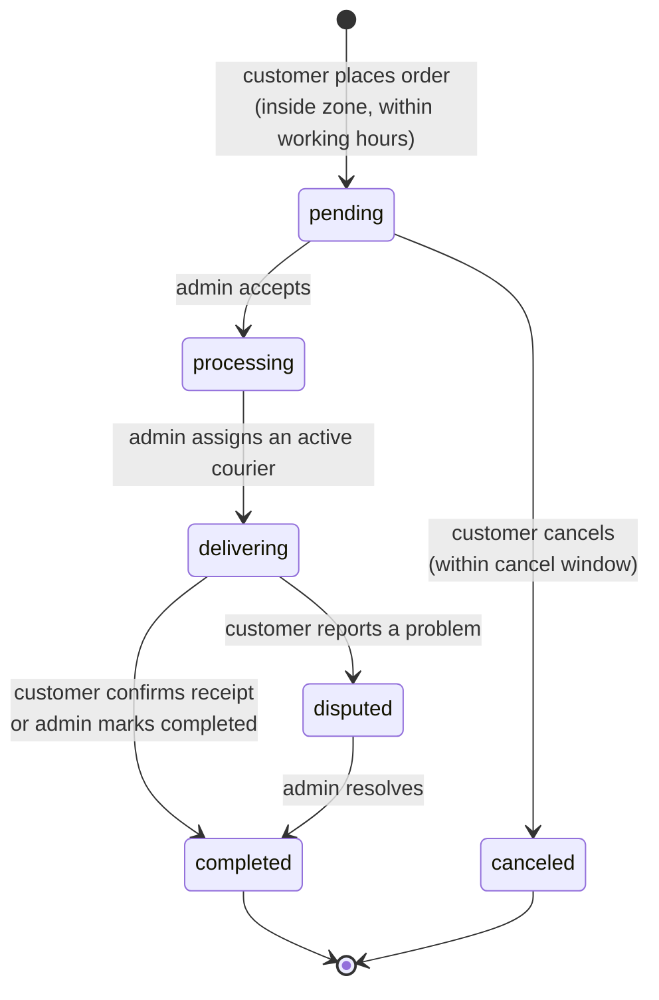
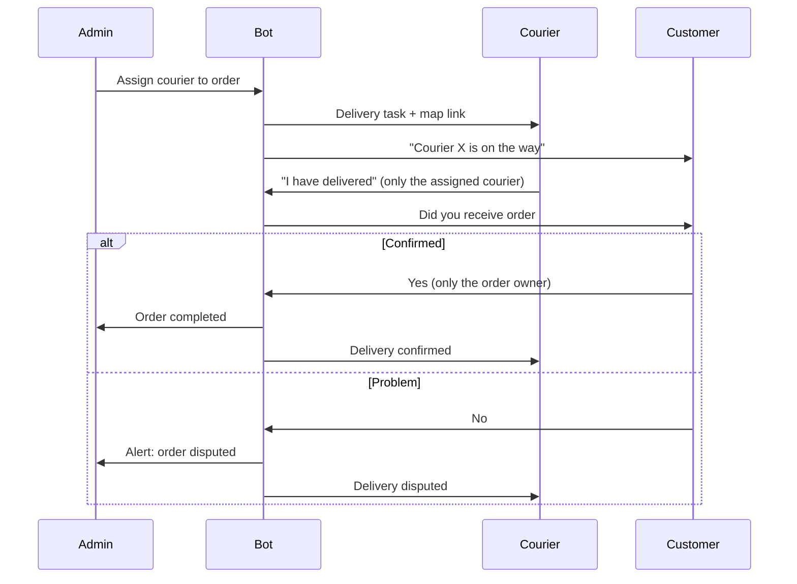
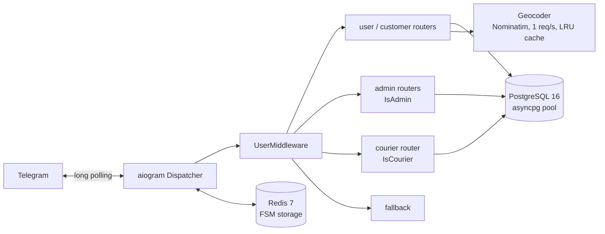

# Dastavka Bot

**English** | [O‘zbekcha](README.uz.md)

[](https://xoliddev.github.io/demos/dastavka-bot/)

[](https://github.com/xoliddev/dastavka-bot/actions/workflows/ci.yml)  


> A food-ordering and delivery bot for a single café or restaurant, running entirely inside Telegram.

Customers browse a multilingual menu and place orders, admins run the kitchen and dispatch couriers from an in-bot panel, and couriers close each delivery with a customer-confirmed hand-off.

---

## Contents

- [Features](#features)
- [Security and authorization model](#security-and-authorization-model)
- [Order lifecycle](#order-lifecycle)
- [Architecture](#architecture)
- [Quick start](#quick-start)
- [Configuration](#configuration)
- [Tests](#tests)
- [Changelog](CHANGELOG.md)

## Features

### Customer
- **Location-aware onboarding.** On `/start` the bot asks for a location, turns it into a readable address with OpenStreetMap Nominatim, and asks the customer to confirm it.
- **Delivery zone.** The location is checked against the café coordinates and radius (haversine). It is checked again at checkout, so an order can never be placed to an address outside the zone.
- **Saved addresses** ("Home", "Work") to pick instead of sharing a location every time.
- **Nested menu.** Categories, sub-categories and product cards with photo, description and price, all paginated.
- **Product variations** (for example Small / Large), each with its own price and photo.
- **Cart.** Quantity picker, increase / decrease / remove items, clear the cart.
- **Checkout.** Name, phone (Telegram contact button or typed number) and delivery location.
- **Working hours.** Orders are refused outside opening hours, in the café's own timezone, with a configurable "last order" buffer. Shifts that cross midnight (for example 18:00 to 03:00) work.
- **Order history** with status and items, plus **self-service cancellation** inside an admin-defined window.
- **Delivery confirmation.** When the courier reports the delivery, the customer confirms receipt or reports a problem.
- **Language switch** between Uzbek, Russian and English.

### Courier
- **Assignment notification** with order number, customer name, phone and a Google Maps link.
- **Active deliveries** list (only the courier's own deliveries).
- **"Delivered" button** that starts the customer confirmation; the courier's message is updated with the final outcome.

### Admin
- **Orders dashboard** by status (new, processing, delivering, completed, canceled, disputed) with date filters (today, this week, this month, or any day from a calendar).
- **Order handling.** Accept, assign a courier (shown as busy or free), mark completed. The customer is notified at each step.
- **Notifications** for new, canceled, completed and disputed orders, sent to every admin by DM and optionally to a staff group (`/set_group`).
- **Menu management.** Categories, sub-categories, products and variations with names and descriptions in every enabled language; edit any field, toggle availability, archive.
- **Courier management.** Add by Telegram ID, view, deactivate and re-activate.
- **Café settings.** Location and delivery radius, working hours, order buffer, cancellation window, content languages, own panel language.
- **Short daily order numbers** (`#1`, `#2`, …) next to the database id, with a reset button for a new day or shift.
- **Daily report.** Today's completed orders, revenue and best-selling product.

All interface text exists in `uz`, `ru` and `en` ([`locales/lexicon.py`](locales/lexicon.py)); a test enforces that every key has all three translations with matching placeholders.

## Security and authorization model

Every update passes through the same chain:

1. **`UserMiddleware`** ([`core/middlewares.py`](core/middlewares.py)) loads or creates the sender's `users` row and syncs the admin role with the configuration.
2. **Role filters on whole routers** ([`core/filters.py`](core/filters.py)). The filter decides whether a router is entered at all, so crafted callback data never reaches a handler the caller may not use:

   | Router | Filter | Who passes |
   |---|---|---|
   | `handlers/admin/*` | `IsAdmin` on messages **and** callback queries | Telegram id listed in `ADMIN_IDS` |
   | `handlers/courier_handlers.py` | `IsCourier` | `users.role = 'courier'` **and** an active row in `couriers` |
   | `handlers/user_handlers.py`, `handlers/customer_handlers.py` | none (public) | everyone; per-object checks below |
   | `handlers/fallback.py` | catch-all | answers any rejected or unknown callback with "not available", and logs it |

3. **Per-object checks** for the actions that touch one order:
   - a customer can confirm, dispute, cancel or view **only their own** order;
   - a courier can view or confirm **only the deliveries assigned to them**, and only while the order is `delivering`, so other couriers cannot read the customer's name or phone;
   - courier assignment accepts only **active** couriers.
4. **Atomic state transitions.** Status changes go through `db_helpers.transition_order_status`, a single `UPDATE … WHERE status = ANY(allowed) [AND user_id = …] [AND courier_id = …] RETURNING`. Double clicks, stale buttons and forged callbacks cannot move an order backwards or skip a step. The allowed transitions are listed in `ORDER_TRANSITIONS`.

Other measures:
- **`ADMIN_IDS` is the only source of admin rights.** A `role = 'admin'` row left in the database grants nothing, and a removed admin is demoted on their next update.
- **User-supplied text is HTML-escaped** before it goes into HTML messages (customer name and phone in admin and courier messages).
- The cancellation window is enforced on the server, not only by hiding the button.
- The container runs as an unprivileged user; secrets come from the environment only.

The handler tests (`tests/handlers/test_authorization.py`) feed forged updates into the real dispatcher and check that nothing changes in the database and nothing leaks.

## Order lifecycle



Courier hand-off:



## Architecture



```
dastavka-bot/
├── bot.py                  # entry point: create_bot, build_dispatcher, --check self-test, graceful shutdown
├── database_setup.py       # idempotent schema + migrations (run on every startup, or by hand)
├── db_helpers.py           # all SQL as async functions; order state machine
├── core/
│   ├── config.py           # typed settings (pydantic-settings)
│   ├── filters.py          # IsAdmin / IsCourier + ownership predicates
│   ├── middlewares.py      # UserMiddleware
│   ├── notify.py           # notifications to admins and the staff group
│   ├── telegram.py         # Bot API request middleware (answer each callback once)
│   └── logging_config.py   # text or JSON structured logs
├── handlers/
│   ├── user_handlers.py    # /start, role routing, location and zone, saved addresses
│   ├── customer_handlers.py# menu, cart, checkout, history, cancel, delivery confirmation
│   ├── courier_handlers.py # courier panel (IsCourier)
│   ├── admin/              # admin panel (IsAdmin): menu, categories, products, variations,
│   │                       #   orders, settings, team; group.py = /set_group
│   └── fallback.py         # answers rejected or unknown callbacks
├── utils/                  # keyboards, geocoder, geo_utils, working_hours, lexicon_utils
├── locales/lexicon.py      # UI strings in uz / ru / en
└── tests/                  # unit, integration (real PostgreSQL) and handler tests
```

Design notes:
- **Daily order numbers** come from one counter row (`INSERT … ON CONFLICT DO UPDATE SET last_value = last_value + 1 RETURNING`) inside the order transaction. The row lock serialises concurrent checkouts, so numbers are unique and have no gaps.
- **Timezone.** Working hours, "today" filters and the daily report use `TIMEZONE` (IANA name, default `Asia/Tashkent`) through `zoneinfo`.
- **Nominatim policy.** A configurable identifying User-Agent, at most one request per second (an async lock plus throttling), and an in-memory LRU cache keyed by about 1 m precision.
- **Schema** is applied on startup inside a transaction holding an advisory lock, so several replicas can start at once. Databases created by the old script are migrated in place.

## Quick start

### Docker Compose (recommended)

```bash
git clone https://github.com/xoliddev/dastavka-bot.git
cd dastavka-bot
cp .env.example .env      # set BOT_TOKEN, ADMIN_IDS, POSTGRES_PASSWORD
docker compose up -d --build
docker compose logs -f bot
```

Compose starts PostgreSQL 16 and Redis 7 with health checks; the bot waits until both are healthy, creates or migrates the schema, then starts polling. `POSTGRES_HOST` and `REDIS_HOST` are overridden inside the compose network, so `.env` can keep `localhost` for local runs.

**Self-test without a real token.** `--check` boots everything up to the point of Telegram authentication: it validates the config and token format, connects to PostgreSQL, applies the schema, pings Redis and builds the dispatcher with every router, then exits with code 0 or 1. No request is sent to Telegram.

```bash
docker compose up -d --wait db redis
docker compose run --rm bot python bot.py --check
# check: BOT_TOKEN format ok
# check: PostgreSQL ok, schema applied server_version=16.x
# check: Redis ok
# check: dispatcher built update_types=callback_query,message
# check: PASSED
```

CI runs the same check (the `docker` job). If you start the bot with a dummy token, it reaches Telegram, gets `401 Unauthorized`, logs `Telegram rejected BOT_TOKEN` and exits with code 2.

### Local run

Requires Python 3.12+, PostgreSQL and Redis.

```bash
python -m venv .venv && source .venv/bin/activate   # Windows: .venv\Scripts\activate
pip install -r requirements.txt
python bot.py --check
python bot.py
```

`python database_setup.py` still creates or migrates the schema by hand if you prefer; the bot also does it on every start.

### First steps in Telegram

1. Send `/start` from an account listed in `ADMIN_IDS`. The admin panel opens.
2. **Settings:** set the café location, delivery radius and working hours.
3. **Menu:** create categories and products.
4. **Team:** add couriers by Telegram id (they must `/start` the bot once first).
5. Optional: add the bot to a staff group and send `/set_group` there to get the `NOTIFICATION_GROUP_ID` value.

## Configuration

Every setting is an environment variable (or a line in `.env`); see [`.env.example`](.env.example) for the full list with comments.

| Variable | Default | Purpose |
|---|---|---|
| `BOT_TOKEN` | (none) | token from @BotFather |
| `ADMIN_IDS` | empty | comma-separated Telegram ids with admin rights |
| `NOTIFICATION_GROUP_ID` | empty | optional staff group for notifications |
| `DATABASE_URL` or `POSTGRES_*` | `localhost:5432/dastavka` | PostgreSQL connection |
| `REDIS_URL` or `REDIS_*` | `localhost:6379/0` | Redis connection (FSM storage) |
| `TIMEZONE` | `Asia/Tashkent` | café timezone (IANA) |
| `NOMINATIM_USER_AGENT` | `dastavka-bot/2.0 (+repo url)` | identifying User-Agent required by Nominatim; put your contact here |
| `NOMINATIM_MIN_INTERVAL` | `1.0` | seconds between geocoding requests |
| `GEOCODER_CACHE_SIZE` | `1024` | cached reverse-geocoding results |
| `LOG_LEVEL` / `LOG_FORMAT` | `INFO` / `text` | `json` gives one JSON object per line |

## Tests

```bash
pip install -r requirements-dev.txt
pytest -q          # unit + integration + handler tests
ruff check . && ruff format --check .
```

What the suite contains, in plain numbers: about 145 behavioural tests that run against a real PostgreSQL (126 dispatcher tests, 86 of them a matrix of 43 forged admin callbacks × 2 roles, plus 19 database tests), about 80 small unit tests, 114 generated checks that every callback_data the code can produce has a handler, and 580 per-key lexicon checks (290 keys × "all languages present" and "placeholders match"). The last two groups are cheap, generated checks, so the raw total (921) overstates the amount of behaviour tested.

- **Unit:** geo utils, working hours (including midnight-crossing shifts, buffers, DST zones), lexicon completeness and placeholders, config parsing, geocoder throttling and cache, permission filters, order state machine, router wiring (every admin module sits behind `IsAdmin`).
- **Integration (real PostgreSQL 16):** order creation, **60 concurrent orders with `asyncio.gather` get unique, gap-free daily numbers**, courier assignment, status transitions and ownership guards, reports, idempotent schema and migration of a database created by the old script.
- **Handler tests:** real `Update` objects are fed into the real `Dispatcher` with a mocked Bot session (no network). They cover the whole happy path (cart → checkout → accept → assign → delivered → confirmed) and the security cases: forged admin callbacks from customers and couriers, confirming another customer's order, a courier who is not assigned to the order, deactivated couriers, malformed callback data, checkout outside the zone, working hours, the cancellation window. Pagination tests page forward and back through long lists (customer categories, sub-categories and products; admin categories, sub-categories, products, couriers and orders; a courier's active deliveries). A handler exception fails the test.
- **Callback routing:** a static scan collects every `callback_data` template from `handlers/` and `utils/keyboards.py` (including `page_callback` lambdas and pagination prefixes), turns each one into a sample and checks that a real handler accepts it. A button whose data no handler understands, like the old `customer_view_cat_page:` buttons, fails this test. It checks routing (the prefix); argument formats are covered by the dispatcher tests.

**Database for tests.** If `TEST_DATABASE_URL` is set, it is used (CI uses a `postgres:16` service container). Otherwise the suite starts a throw-away `postgres:16-alpine` container with `docker run` on a random port and removes it afterwards. Without either, database tests are skipped. `DATABASE_URL` is never used by tests, so a real database cannot be wiped by accident.

## License

[MIT](LICENSE) © 2026 xoliddev
