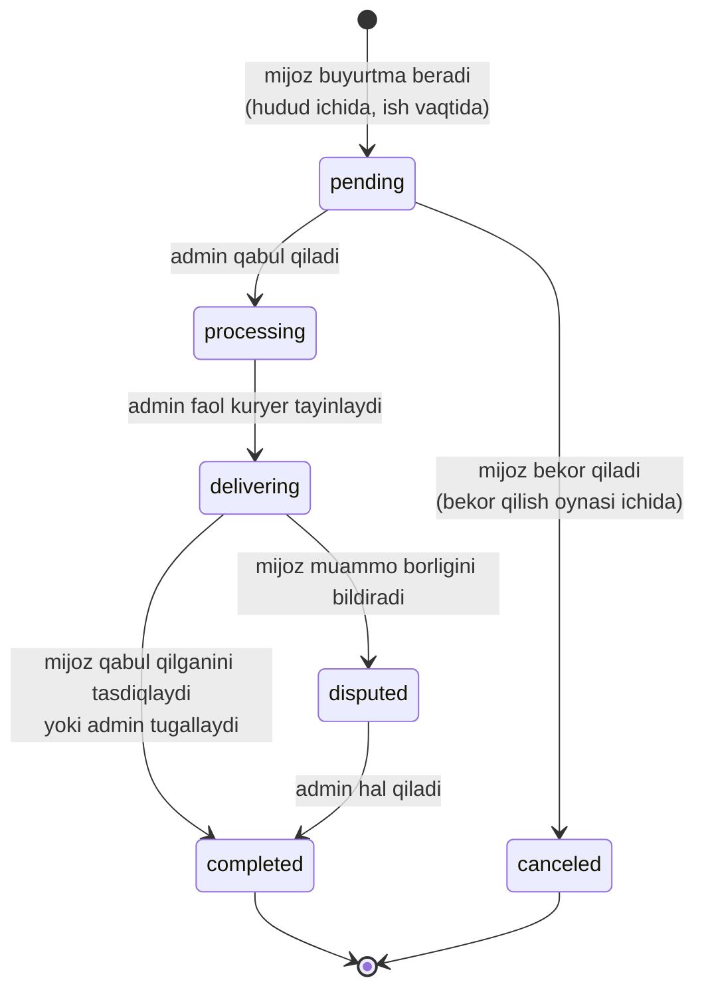
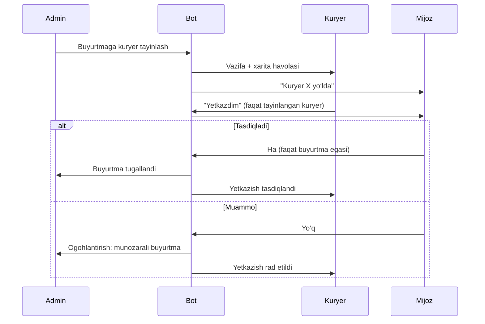
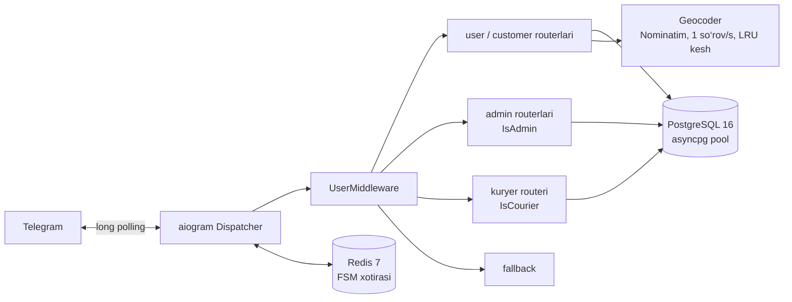

# Dastavka Bot

[English](README.md) | **O‘zbekcha**

[](https://xoliddev.github.io/demos/dastavka-bot/)

[](https://github.com/xoliddev/dastavka-bot/actions/workflows/ci.yml)  


> Bitta kafe yoki restoran uchun buyurtma va yetkazib berish boti. Hammasi Telegram ichida ishlaydi.

Mijoz ko‘p tilli menyudan taom tanlab buyurtma beradi, admin bot ichidagi panel orqali oshxona va kuryerlarni boshqaradi, kuryer esa har bir yetkazishni mijoz tasdig‘i bilan yopadi.

---

## Mundarija

- [Imkoniyatlar](#imkoniyatlar)
- [Xavfsizlik va ruxsatlar modeli](#xavfsizlik-va-ruxsatlar-modeli)
- [Buyurtmaning hayot sikli](#buyurtmaning-hayot-sikli)
- [Arxitektura](#arxitektura)
- [Tez ishga tushirish](#tez-ishga-tushirish)
- [Sozlamalar](#sozlamalar)
- [Testlar](#testlar)
- [O‘zgarishlar tarixi](CHANGELOG.md)

## Imkoniyatlar

### Mijoz
- **Lokatsiya bilan boshlash.** `/start` bosilganda bot lokatsiya so‘raydi, OpenStreetMap Nominatim orqali uni o‘qiladigan manzilga aylantiradi va mijozdan tasdiqlashni so‘raydi.
- **Yetkazib berish hududi.** Lokatsiya kafe koordinatalari va radiusi bilan solishtiriladi (haversine formulasi). Buyurtmani rasmiylashtirish paytida ham qayta tekshiriladi, shuning uchun hududdan tashqaridagi manzilga buyurtma berib bo‘lmaydi.
- **Saqlangan manzillar** ("Uy", "Ish"): har safar lokatsiya yubormasdan tanlash mumkin.
- **Ichma-ich menyu.** Kategoriyalar, ichki kategoriyalar va rasm, tavsif hamda narxli mahsulot kartalari, hammasi sahifalab ko‘rsatiladi.
- **Mahsulot variantlari** (masalan, Kichik / Katta), har birining o‘z narxi va rasmi bor.
- **Savatcha.** Miqdor tanlash, ko‘paytirish, kamaytirish, o‘chirish, savatchani tozalash.
- **Buyurtma berish.** Ism, telefon (Telegram kontakt tugmasi yoki qo‘lda yozilgan raqam) va yetkazish lokatsiyasi.
- **Ish vaqti.** Ish vaqtidan tashqarida buyurtma qabul qilinmaydi. Vaqt kafening o‘z vaqt mintaqasida hisoblanadi, yopilishdan oldingi "oxirgi buyurtma" buferi sozlanadi. Yarim tundan o‘tadigan smenalar (masalan, 18:00 dan 03:00 gacha) ham to‘g‘ri ishlaydi.
- **Buyurtmalar tarixi** holati va tarkibi bilan, hamda admin belgilagan vaqt ichida **buyurtmani o‘zi bekor qilish**.
- **Yetkazilganini tasdiqlash.** Kuryer "yetkazdim" deganda mijoz qabul qilganini tasdiqlaydi yoki muammo borligini bildiradi.
- **Tilni almashtirish:** o‘zbek, rus va ingliz tillari.

### Kuryer
- **Yangi vazifa haqida xabar:** buyurtma raqami, mijoz ismi, telefoni va Google Maps havolasi.
- **Faol yetkazishlar** ro‘yxati (faqat kuryerning o‘ziga tegishlilari).
- **"Yetkazdim" tugmasi** mijoz tasdig‘ini so‘raydi; kuryerdagi xabar yakuniy natija bilan yangilanadi.

### Admin
- **Buyurtmalar paneli** holat bo‘yicha (yangi, jarayonda, yetkazilmoqda, tugallangan, bekor qilingan, munozarali) va sana bo‘yicha filtr (bugun, shu hafta, shu oy yoki kalendardan istalgan kun).
- **Buyurtmani boshqarish.** Qabul qilish, kuryer tayinlash (kuryer band yoki bo‘shligi ko‘rinadi), tugallangan deb belgilash. Har bir bosqichda mijozga xabar boradi.
- **Bildirishnomalar:** yangi, bekor qilingan, tugallangan va munozarali buyurtmalar haqida har bir adminga shaxsiy xabar, xohlasa xodimlar guruhiga ham (`/set_group`).
- **Menyuni boshqarish.** Kategoriya, ichki kategoriya, mahsulot va variantlar; nom va tavsif yoqilgan har bir tilda kiritiladi; istalgan maydonni tahrirlash, mavjudligini yoqish/o‘chirish, arxivlash.
- **Kuryerlarni boshqarish.** Telegram ID orqali qo‘shish, ko‘rish, faolsizlantirish va qayta faollashtirish.
- **Kafe sozlamalari.** Lokatsiya va yetkazish radiusi, ish vaqti, buyurtma buferi, bekor qilish oynasi, kontent tillari, admin panelining tili.
- **Qisqa kunlik raqamlar** (`#1`, `#2`, …) bazadagi ID bilan birga; yangi kun yoki smena uchun nolga qaytarish tugmasi bor.
- **Kunlik hisobot:** bugungi tugallangan buyurtmalar soni, tushum va eng ko‘p sotilgan mahsulot.

Interfeysdagi barcha matnlar `uz`, `ru` va `en` tillarida bor ([`locales/lexicon.py`](locales/lexicon.py)). Test har bir kalitda uchala tarjima borligini va `{...}` o‘rinlari bir xilligini tekshiradi.

## Xavfsizlik va ruxsatlar modeli

Har bir update bir xil yo‘ldan o‘tadi:

1. **`UserMiddleware`** ([`core/middlewares.py`](core/middlewares.py)) yuboruvchining `users` qatorini oladi yoki yaratadi va admin rolini konfiguratsiya bilan moslaydi.
2. **Butun routerlarga qo‘yilgan rol filtrlari** ([`core/filters.py`](core/filters.py)). Filtr routerga umuman kirish yoki kirmaslikni hal qiladi, shuning uchun soxta callback ma’lumoti ruxsat berilmagan handlerga yetib bormaydi:

   | Router | Filtr | Kim o‘tadi |
   |---|---|---|
   | `handlers/admin/*` | xabarlar **va** callback’larda `IsAdmin` | Telegram ID’si `ADMIN_IDS` ro‘yxatida bo‘lganlar |
   | `handlers/courier_handlers.py` | `IsCourier` | `users.role = 'courier'` **va** `couriers` jadvalida faol qatori borlar |
   | `handlers/user_handlers.py`, `handlers/customer_handlers.py` | yo‘q (ochiq) | hamma; quyidagi obyekt darajasidagi tekshiruvlar bilan |
   | `handlers/fallback.py` | qolgan hammasi | rad etilgan yoki noma’lum callback’ga "mavjud emas" deb javob beradi va logga yozadi |

3. **Bitta buyurtmaga oid amallarda obyekt darajasidagi tekshiruv:**
   - mijoz faqat **o‘z** buyurtmasini tasdiqlay, rad eta, bekor qila yoki ko‘ra oladi;
   - kuryer faqat **o‘ziga tayinlangan** yetkazishni ko‘ra va tasdiqlay oladi, u ham buyurtma `delivering` holatida bo‘lsa. Boshqa kuryer mijozning ismi va telefonini ko‘rolmaydi;
   - buyurtmaga faqat **faol** kuryerni tayinlash mumkin.
4. **Atomik holat o‘tishlari.** Holat faqat `db_helpers.transition_order_status` orqali o‘zgaradi: bitta `UPDATE … WHERE status = ANY(ruxsat etilganlar) [AND user_id = …] [AND courier_id = …] RETURNING`. Ikki marta bosish, eskirgan tugma yoki soxta callback buyurtmani orqaga qaytara olmaydi va bosqichni sakrab o‘tolmaydi. Ruxsat etilgan o‘tishlar `ORDER_TRANSITIONS` da yozilgan.

Qo‘shimcha choralar:
- **Admin huquqining yagona manbai `ADMIN_IDS`.** Bazada qolib ketgan `role = 'admin'` hech qanday huquq bermaydi, ro‘yxatdan olib tashlangan admin keyingi update’dayoq oddiy foydalanuvchiga aylanadi.
- **Foydalanuvchi kiritgan matn HTML-ekranlanadi** (admin va kuryerga boradigan xabarlardagi mijoz ismi va telefoni).
- Bekor qilish oynasi faqat tugmani yashirish bilan emas, serverda ham tekshiriladi.
- Konteyner imtiyozsiz foydalanuvchi nomidan ishlaydi; maxfiy ma’lumotlar faqat muhit o‘zgaruvchilaridan olinadi.

Handler testlari (`tests/handlers/test_authorization.py`) haqiqiy dispatcher’ga soxta update’lar yuborib, bazada hech narsa o‘zgarmaganini va hech qanday ma’lumot chiqib ketmaganini tekshiradi.

## Buyurtmaning hayot sikli



Kuryerga topshirish:



## Arxitektura



```
dastavka-bot/
├── bot.py                  # kirish nuqtasi: create_bot, build_dispatcher, --check, to‘g‘ri to‘xtash
├── database_setup.py       # idempotent sxema va migratsiyalar (har ishga tushishda yoki qo‘lda)
├── db_helpers.py           # barcha SQL so‘rovlar async funksiyalar ko‘rinishida; buyurtma holatlari
├── core/
│   ├── config.py           # tiplangan sozlamalar (pydantic-settings)
│   ├── filters.py          # IsAdmin / IsCourier va egalik tekshiruvlari
│   ├── middlewares.py      # UserMiddleware
│   ├── notify.py           # adminlar va xodimlar guruhiga xabarlar
│   ├── telegram.py         # Bot API so‘rov middleware’i (callback’ga bir marta javob)
│   └── logging_config.py   # matn yoki JSON ko‘rinishidagi strukturali loglar
├── handlers/
│   ├── user_handlers.py    # /start, rol bo‘yicha yo‘naltirish, lokatsiya va hudud, saqlangan manzillar
│   ├── customer_handlers.py# menyu, savatcha, buyurtma, tarix, bekor qilish, tasdiqlash
│   ├── courier_handlers.py # kuryer paneli (IsCourier)
│   ├── admin/              # admin paneli (IsAdmin): menyu, kategoriyalar, mahsulotlar, variantlar,
│   │                       #   buyurtmalar, sozlamalar, jamoa; group.py = /set_group
│   └── fallback.py         # rad etilgan yoki noma’lum callback’larga javob
├── utils/                  # klaviaturalar, geocoder, geo_utils, working_hours, lexicon_utils
├── locales/lexicon.py      # uz / ru / en matnlari
└── tests/                  # unit, integratsion (haqiqiy PostgreSQL) va handler testlari
```

Muhim yechimlar:
- **Kunlik buyurtma raqamlari** buyurtma tranzaksiyasi ichida bitta hisoblagich qatoridan olinadi (`INSERT … ON CONFLICT DO UPDATE SET last_value = last_value + 1 RETURNING`). Qator qulfi bir vaqtdagi buyurtmalarni navbatga qo‘yadi, shuning uchun raqamlar takrorlanmaydi va orada bo‘shliq qolmaydi.
- **Vaqt mintaqasi.** Ish vaqti, "bugun" filtrlari va kunlik hisobot `TIMEZONE` (IANA nomi, standart `Asia/Tashkent`) bo‘yicha `zoneinfo` orqali hisoblanadi.
- **Nominatim qoidalari.** Sozlanadigan, botni tanitadigan User-Agent, soniyasiga ko‘pi bilan bitta so‘rov (async qulf va kutish) va taxminan 1 metr aniqlikdagi xotiradagi LRU kesh.
- **Sxema** ishga tushishda advisory lock ostidagi tranzaksiyada qo‘llanadi, shuning uchun bir nechta nusxa bir vaqtda ishga tushsa ham muammo bo‘lmaydi. Eski skript yaratgan bazalar joyida yangilanadi.

## Tez ishga tushirish

### Docker Compose (tavsiya etiladi)

```bash
git clone https://github.com/xoliddev/dastavka-bot.git
cd dastavka-bot
cp .env.example .env      # BOT_TOKEN, ADMIN_IDS, POSTGRES_PASSWORD ni kiriting
docker compose up -d --build
docker compose logs -f bot
```

Compose health check’lari bilan PostgreSQL 16 va Redis 7 ni ishga tushiradi; bot ikkalasi tayyor bo‘lguncha kutadi, sxemani yaratadi yoki yangilaydi, keyin polling’ni boshlaydi. Compose tarmog‘i ichida `POSTGRES_HOST` va `REDIS_HOST` almashtiriladi, shuning uchun `.env` da lokal ishga tushirish uchun `localhost` qolaverishi mumkin.

**Haqiqiy tokensiz o‘z-o‘zini tekshirish.** `--check` hamma narsani Telegram autentifikatsiyasigacha ishga tushiradi: konfiguratsiya va token formatini tekshiradi, PostgreSQL’ga ulanadi, sxemani qo‘llaydi, Redis’ni tekshiradi va barcha routerlar bilan dispatcher’ni yig‘adi, so‘ng 0 yoki 1 kodi bilan chiqadi. Telegram’ga hech qanday so‘rov yuborilmaydi.

```bash
docker compose up -d --wait db redis
docker compose run --rm bot python bot.py --check
# check: BOT_TOKEN format ok
# check: PostgreSQL ok, schema applied server_version=16.x
# check: Redis ok
# check: dispatcher built update_types=callback_query,message
# check: PASSED
```

CI ham xuddi shu tekshiruvni bajaradi (`docker` job). Bot soxta token bilan ishga tushirilsa, Telegram’gacha yetib boradi, `401 Unauthorized` oladi, logga `Telegram rejected BOT_TOKEN` deb yozadi va 2 kodi bilan chiqadi.

### Lokal ishga tushirish

Python 3.12+, PostgreSQL va Redis kerak.

```bash
python -m venv .venv && source .venv/bin/activate   # Windows: .venv\Scripts\activate
pip install -r requirements.txt
python bot.py --check
python bot.py
```

Xohlasangiz, sxemani `python database_setup.py` bilan qo‘lda ham yaratish yoki yangilash mumkin; bot buni har ishga tushganda o‘zi ham qiladi.

### Telegram’dagi birinchi qadamlar

1. `ADMIN_IDS` ro‘yxatidagi akkauntdan `/start` yuboring. Admin paneli ochiladi.
2. **Sozlamalar:** kafe lokatsiyasi, yetkazish radiusi va ish vaqtini belgilang.
3. **Menyu:** kategoriya va mahsulotlarni qo‘shing.
4. **Jamoa:** kuryerlarni Telegram ID orqali qo‘shing (ular avval botga bir marta `/start` yuborgan bo‘lishi kerak).
5. Ixtiyoriy: botni xodimlar guruhiga qo‘shing va `NOTIFICATION_GROUP_ID` qiymatini olish uchun u yerda `/set_group` yuboring.

## Sozlamalar

Har bir sozlama muhit o‘zgaruvchisi (yoki `.env` dagi qator). To‘liq ro‘yxat izohlari bilan [`.env.example`](.env.example) faylida.

| O‘zgaruvchi | Standart qiymat | Vazifasi |
|---|---|---|
| `BOT_TOKEN` | (yo‘q) | @BotFather bergan token |
| `ADMIN_IDS` | bo‘sh | admin huquqli Telegram ID’lar, vergul bilan |
| `NOTIFICATION_GROUP_ID` | bo‘sh | bildirishnomalar uchun ixtiyoriy xodimlar guruhi |
| `DATABASE_URL` yoki `POSTGRES_*` | `localhost:5432/dastavka` | PostgreSQL ulanishi |
| `REDIS_URL` yoki `REDIS_*` | `localhost:6379/0` | Redis ulanishi (FSM xotirasi) |
| `TIMEZONE` | `Asia/Tashkent` | kafe vaqt mintaqasi (IANA) |
| `NOMINATIM_USER_AGENT` | `dastavka-bot/2.0 (+repo havolasi)` | Nominatim talab qiladigan User-Agent; bu yerga o‘z kontaktingizni yozing |
| `NOMINATIM_MIN_INTERVAL` | `1.0` | geokodlash so‘rovlari orasidagi soniyalar |
| `GEOCODER_CACHE_SIZE` | `1024` | keshda saqlanadigan natijalar soni |
| `LOG_LEVEL` / `LOG_FORMAT` | `INFO` / `text` | `json` har bir qatorda bitta JSON obyekt chiqaradi |

## Testlar

```bash
pip install -r requirements-dev.txt
pytest -q          # unit, integratsion va handler testlari
ruff check . && ruff format --check .
```

Oddiy raqamlarda: haqiqiy PostgreSQL bilan ishlaydigan 145 ga yaqin xatti-harakat testi (126 ta dispatcher testi, ulardan 86 tasi 43 ta soxta admin callback × 2 rol matritsasi, yana 19 ta baza testi), 80 ga yaqin kichik unit test, kod yaratishi mumkin bo‘lgan har bir callback_data uchun handler borligini tekshiradigan 114 ta avtomatik tekshiruv va lug‘atdagi har bir kalit uchun 580 ta tekshiruv (290 kalit × "hamma tillar bor" va "o‘rinlar mos"). Oxirgi ikki guruh arzon, avtomatik yaratilgan tekshiruvlar, shuning uchun umumiy son (921) haqiqatda sinalgan xatti-harakatdan ancha ko‘p ko‘rinadi.

- **Unit:** geo yordamchilari, ish vaqti (yarim tundan o‘tuvchi smenalar, bufer, yozgi vaqtli mintaqalar), lug‘at to‘liqligi va o‘rinlari, konfiguratsiya, geocoder’ning kutish va kesh mantiqi, ruxsat filtrlari, buyurtma holatlari mashinasi, routerlar ulanishi (har bir admin moduli `IsAdmin` ortida turibdi).
- **Integratsion (haqiqiy PostgreSQL 16):** buyurtma yaratish, **`asyncio.gather` bilan bir vaqtda berilgan 60 ta buyurtma takrorlanmaydigan va uzluksiz kunlik raqam oladi**, kuryer tayinlash, holat o‘tishlari va egalik tekshiruvlari, hisobotlar, sxemaning idempotentligi va eski skript yaratgan bazaning migratsiyasi.
- **Handler testlari:** haqiqiy `Update` obyektlari haqiqiy `Dispatcher` ga yuboriladi, Bot sessiyasi esa soxta (tarmoqqa chiqilmaydi). To‘liq ijobiy ssenariy (savatcha → buyurtma → qabul → tayinlash → yetkazildi → tasdiqlandi) va xavfsizlik holatlari tekshiriladi: mijoz va kuryerdan kelgan soxta admin callback’lari, boshqa mijozning buyurtmasini tasdiqlash, buyurtmaga tayinlanmagan kuryer, faolsizlantirilgan kuryer, buzilgan callback ma’lumotlari, hududdan tashqarida buyurtma, ish vaqti, bekor qilish oynasi. Sahifalash testlari uzun ro‘yxatlarda oldinga va orqaga o‘tadi (mijoz uchun kategoriyalar, ichki kategoriyalar va mahsulotlar; admin uchun kategoriyalar, ichki kategoriyalar, mahsulotlar, kuryerlar va buyurtmalar; kuryerning faol yetkazishlari). Handler’da xato chiqsa, test yiqiladi.
- **Callback yo‘naltirish:** statik skaner `handlers/` va `utils/keyboards.py` dagi har bir `callback_data` shablonini (shu jumladan `page_callback` lambdalari va sahifalash prefikslarini) yig‘adi, har biridan namuna yasaydi va uni haqiqiy handler qabul qilishini tekshiradi. Eski `customer_view_cat_page:` kabi hech bir handler tushunmaydigan tugma paydo bo‘lsa, test yiqiladi. Bu test yo‘naltirishni (prefiksni) tekshiradi; argumentlar formati dispatcher testlarida tekshiriladi.

**Testlar uchun baza.** `TEST_DATABASE_URL` berilgan bo‘lsa, o‘sha ishlatiladi (CI’da `postgres:16` service konteyneri). Aks holda test to‘plami `docker run` orqali tasodifiy portda vaqtinchalik `postgres:16-alpine` konteynerini ko‘taradi va oxirida o‘chiradi. Ikkalasi ham bo‘lmasa, bazaga oid testlar o‘tkazib yuboriladi. Testlar `DATABASE_URL` ni hech qachon ishlatmaydi, shuning uchun haqiqiy baza tasodifan tozalanib ketmaydi.

## Litsenziya

[MIT](LICENSE) © 2026 xoliddev
